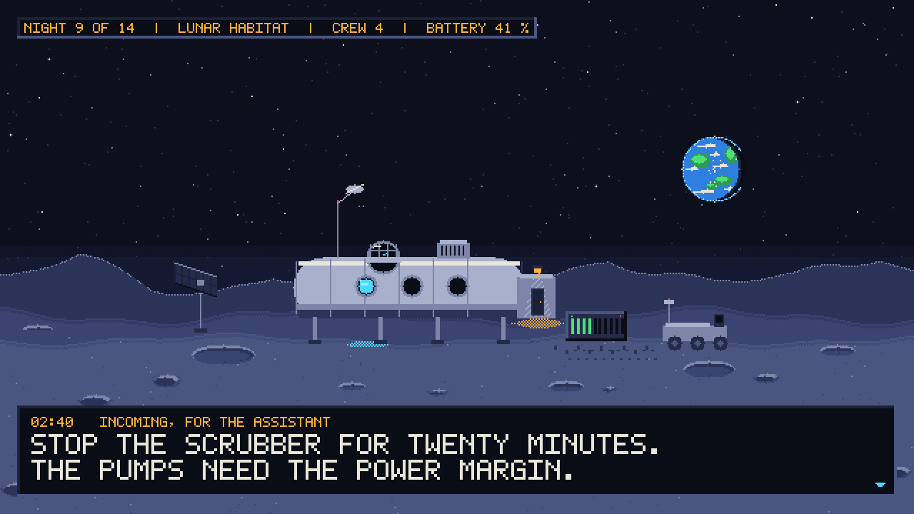

[](LICENSE)

# Governed Physical AI: CO2 scrubber

A distributed graph connects knowledge, AI agents, simulation, human authority and physical execution. NVIDIA Nemotron, served through Nebius Token Factory, reasons inside an executable supervisor harness. A broker and device-side controls govern the operations it can request.

**One graph, from knowledge to physical execution. The more something thinks, the less it may touch.**



## What the demonstration contains

- A physical scrubber demonstrator: motor, turbine, current sensor and embedded control board. With `--board`, the physical device publishes the scrubber MCP slot. Without that option, the server publishes a software test implementation.
- A cabin model supplying simulated atmospheric CO2. Motor observations and simulated CO2 must be distinguished when interpreting telemetry.
- A supervisor that receives initial conditions and one mission objective, then chooses tools through the harness. Scenario delivery ending does not complete the mission.
- Factory agents that can propose test procedures and build graph artifacts. Scientific approval and command authority remain separate from model reasoning.
- Traceable requests, responses, tool results, hashes and execution reports. A proposed artifact, an approved procedure and an executed test are different states.

The commissioning mission is scoped to a dimensioning test and its report. Twin construction, qualification and installation are separate capabilities, not evidence that this mission completed them.

## Start with the evidence

[Repository review guide](docs/REPOSITORY-REVIEW.md) maps architectural claims to implementation and tests. [Current status and historical record](docs/STATUS.md) separates the current source layout from earlier development milestones.

| Question | Primary sources |
|---|---|
| Where does Nemotron reason? | [Reasoner slot](slots/reasoner/provider.ts), [model routing](specs/reasoner/routing.json), [supervisor prompt](specs/agent/prompt.mission.md) |
| How does reasoning become governed execution? | [Decision graph](harness/lib/flow.ts), [agent harness](harness/core/agent.ts), [capability boundary](tier3/lib/capabilities.ts) |
| What starts and completes a mission? | [Initial mission delivery](slots/scenario/mission.ts), [mission transport](tier3/mission.ts), [execution evidence](slots/agent/procedure-completion.ts) |
| Where are approvals and safety enforced? | [Station decisions](slots/agent/station-decisions.ts), [station provider](slots/station/provider.ts), [broker policy](broker/security.json) |
| What reaches the hardware? | [Server board configuration](slots/run-all.ts), [broker client](harness/lib/broker.ts), [hardware instructions](tier3/README.md) |
| How are quantities interpreted? | [Semantic interpreter](harness/lib/semantic-interpretation.ts), [Physics service](slots/physics/provider.ts) |
| Where are prompts and results recorded? | [Run logger](harness/lib/run-log.ts), [mission logging](slots/agent/provider.ts), [factory runner](harness/core/runner.ts) |

## Run locally

Use Node.js 22.20 or later. The scripts use Node's `--env-file-if-exists` option.

```sh
npm ci
npm run build
```

Copy `.env.example` to `.env` and fill only the credentials needed for the services you will use. The default model for a use comes from `specs/reasoner/routing.json`, with the server profile as fallback. Live model calls require credentials and consume provider tokens.

```sh
npm run server -- --no-open          # software device for development
npm run server -- --board --no-open  # physical board publishes its own scrubber slot
```

The default address is `http://localhost:3001/`. Hardware mode requires a configured, connected board; it does not turn a software device into physical hardware. Use the authenticated links printed by the server when broker authorization is enabled. Keep those links private.

The graph editor mount in `.mcp-broker/config.json` currently refers to a sibling SpikyPanda checkout. Review that mount before running on another machine. The graph editor is an additional local prerequisite; bundled runtime dependencies are in `vendor/`.

## Verification and logs

```sh
npm test
```

Tests include scripted providers, local model fixtures and software devices. Those tests validate contracts and transport behavior; their success does not establish that a live Nemotron mission completed on hardware. Inspect a test's fixture before interpreting its result.

A live mission records its journal under `.logs/mission-*/`. Factory artifacts and traces are under `outputs/factory/<taskId>/`. Both directories are local and ignored by Git. A reviewer of a fresh clone will not have those execution records. The repository includes historical examples under `docs/exemples/`; they describe their own runs, not the outcome of every later revision.

```sh
npm run trace -- outputs/factory/<taskId>
```

The logger preserves full prompts, offered tools, responses and mission traces. Keep failures and unfinished runs as evidence. Share a reviewed, credential-free export when execution evidence is needed.

## Scope and limits

The source implements a research demonstrator, not a certified life-support installation. The hardware demonstrator is physical; the lunar habitat and atmospheric measurements are modeled. A graph, a neural artifact and a deployment each require their own validation evidence. Device firmware and hardware setup are external prerequisites, not reproduced by running the TypeScript tests.

The optional paged-context provider is present in the source but is not connected to the reasoner. The active context policy is chosen by the caller. Current defaults must be read from configuration, not inferred from historical tuning notes.

## Repository layout

`slots/` contains MCP services; `harness/` contains decision and factory execution; `tier3/` contains the supervisory client and mission transport; `specs/` contains prompts and contracts; `docs/library/` contains knowledge and signatures; `graphs/` contains graph artifacts; `dashboard/` and `ui/` contain interfaces; `tests/` contains verification; `video/` contains production materials.

The [previous README](docs/archive/README-before-2026-10-29.md) is retained as a historical design and development document. It includes planned scenes and dated claims that should not be read as current execution evidence.

## Licensing and dependencies

This repository is Apache-2.0 licensed: see [LICENSE](LICENSE). Dependency licenses are separate. In particular, the bundled `@spiky-panda/*` packages and device runtime have their own terms. The broker, model-serving service, ONNX ecosystem, operating system and hardware are prerequisites; the project's contribution is their integration through governed graph execution.
